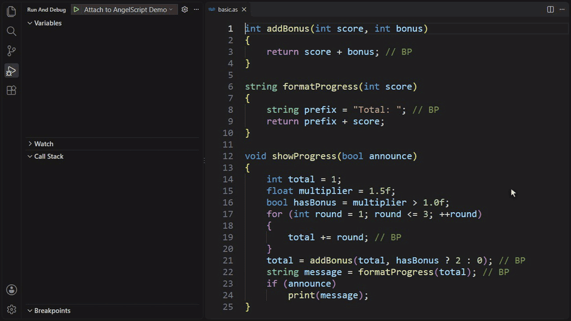

# Ejemplo del depurador de AngelScript

[English](README.md)

Ejecuta y depura AngelScript en una aplicación anfitriona independiente escrita
en C++20. La aplicación integra AngelScript 2.39.0 y el núcleo de asdebugger, y
escucha conexiones del protocolo de depuración (DAP) en `127.0.0.1:9002`.

<p align="center"></p>

## Requisitos

- Visual Studio 2022 o posterior, o sus Build Tools, con la carga de trabajo **Desarrollo para el escritorio con C++** y las herramientas MSVC x64.
- CMake 3.21+, Ninja, Git y Python 3. La primera compilación requiere acceso a internet para descargar dependencias.
- VS Code con la extensión de AngelScript para la depuración interactiva. [Extensión de AngelScript](https://marketplace.visualstudio.com/items?itemName=Gaftherman.angelscript-gaftherman)
- Node.js 18+ para la prueba automatizada de DAP.

## Inicio rápido

Desde la raíz del repositorio en PowerShell:

```powershell
git submodule update --init --recursive
.\run-demo.cmd
```

La entrada del depurador en `.gitmodules` es provisional mientras se publica
la rama `refactor/host-agnostic-core`. Por ahora, el comando de submódulos
descarga AngelScript. Para el depurador, usa una copia local que incluya el
núcleo para aplicaciones anfitrionas:

```powershell
.\run-demo.cmd --asdebugger-dir "..\asdebugger"
```

Sustituye `..\asdebugger` por la ruta de tu copia. El comando guarda
`ASDEBUGGER_DIR` en la caché de CMake. Cuando se publique el commit del
depurador y este repositorio lo registre como submódulo,
`git submodule update --init --recursive` descargará ambas dependencias.
Para cambiar una compilación existente al submódulo, usa
`--asdebugger-dir .\external\asdebugger`.

1. Abre el repositorio en VS Code. Abre `scripts/basic.as` y pulsa **F9** en una línea que termine en `// BP`.
2. Selecciona **Attach to AngelScript Demo** y pulsa **F5**. La aplicación espera a que el cliente termine de configurar los puntos de interrupción antes de ejecutar los scripts.
3. Usa los controles para avanzar paso a paso, entrar en una función o continuar. Cuando termines, detén la aplicación con **Ctrl+C**.

Para compilar e iniciar la aplicación desde VS Code, selecciona
**Launch AngelScript Demo**. Si usas una copia local del depurador, ejecuta
primero `run-demo.cmd --build-only --asdebugger-dir <ruta>`. La tarea de
compilación usará la ruta guardada en la caché.

## Qué verás

- En `basic.as`, inspecciona `total` antes y después de ejecutar `addBonus`. Entra en `formatProgress` y revisa la pila de llamadas.
- En `advanced.as`, expande los miembros heredados de `Scout`, los arrays de enteros y de referencias `Player@` y el diccionario en **Variables**. Un callback invoca una función recursiva.
- Activa **All Exceptions** en el panel de puntos de interrupción antes de iniciar. La demostración provoca una excepción por un índice fuera de rango al arrancar. Al continuar, la aplicación muestra el error y sigue ejecutándose.
- Ambos scripts ejecutan `Tick()` aproximadamente cada 250 ms. Puedes añadir puntos de interrupción después del arranque.

## Prueba automatizada

```powershell
.\run-demo.cmd --test
.\run-demo.cmd --test-launch
```

El comando inicia una instancia de la aplicación en modo de espera, ejecuta
el cliente DAP sin dependencias adicionales, detiene la aplicación y devuelve
el código de salida de la prueba. El segundo comando prueba la petición
`launch` de DAP que usa la configuración de inicio de VS Code. Si usas una
copia local del depurador, pasa `--asdebugger-dir <ruta>` en la primera
compilación.

## Usa el núcleo en tu propia aplicación

La sección **Using the core in your own host** muestra cómo enlazar
`asdebugger_core`, usar `StdHostAdapter` con los complementos estándar,
conectar contextos y atender al depurador entre ejecuciones. Para enlaces
personalizados, implementa `asIDBHostAdapter`. [README de asdebugger](https://github.com/Gaftherman/asdebugger#using-the-core-in-your-own-host)

## Sven Co-op

Para un servidor de Sven Co-op, usa el plugin de Metamod del mismo proyecto.
[Plugin asdebugger](https://github.com/Gaftherman/asdebugger)

## Solución de problemas

- **Falta el núcleo o el SDK.** Inicializa los submódulos. Mientras la entrada del depurador siga siendo provisional, pasa `--asdebugger-dir` o configura CMake con `-DASDEBUGGER_DIR=<ruta>`.
- **Puerto 9002 ocupado.** Detén la instancia anterior o usa `--port N` y configura el mismo puerto en VS Code. Para iniciar desde VS Code, añade también `--port N` a los `args` del ejecutable.
- **El depurador no se detiene.** Abre esta carpeta como espacio de trabajo en VS Code, selecciona la configuración `dap` y usa una línea ejecutable marcada con `// BP`.
- **Scripts propios.** Compila con `run-demo.cmd --build-only` y ejecuta `build\bin\Release\angelscript-demo.exe --wait scripts/basic.as` desde la raíz del repositorio. Puedes indicar varios scripts. Cada uno debe definir `void main()`. La aplicación usa `void Tick()` si existe y, en caso contrario, repite `main()`.
