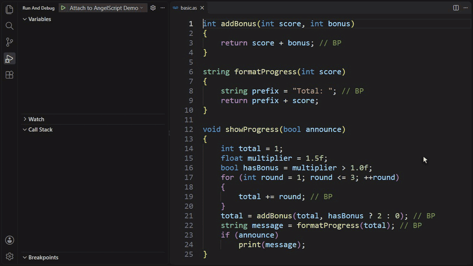
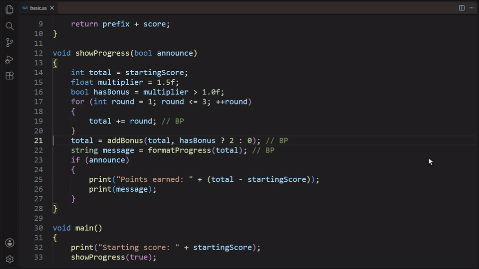
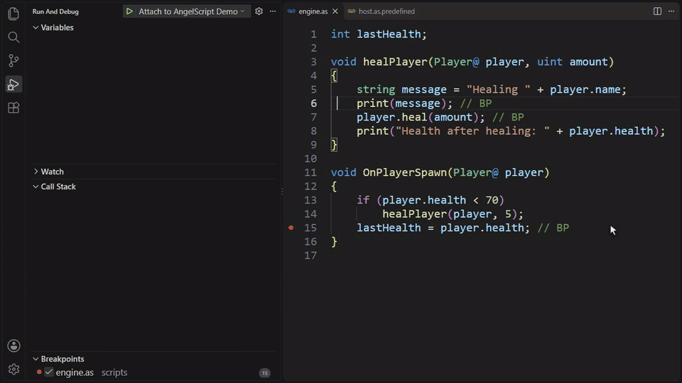

# AngelScript Debugger Example

Run and debug AngelScript in a small C++ host. [Español](README.es.md)

<p align="center"></p>
<p align="center"><em>Attach in VS Code, step through AngelScript, and inspect variables and the call stack.</em></p>

## Project layout

```text
└── 📁 angelscript-debugger-example
    ├── 📁 .vscode
    │   ├── 📄 launch.json         Attach and Launch configurations
    │   ├── 📄 settings.json       Predefined stub setting
    │   └── 📄 tasks.json          Build task for Launch
    ├── 📁 host
    │   └── 📄 main.cpp            C++ host, print, Player, and the DAP server
    ├── 📁 scripts
    │   ├── 📄 basic.as            Score calculation and function calls
    │   ├── 📄 advanced.as         Objects, collections, and exceptions
    │   ├── 📄 engine.as           Host calls and callbacks
    │   └── 📄 host.as.predefined  Host API declarations
    ├── 📁 media
    └── 📄 run-demo.cmd            Build, run, and test the demo
```

## Quick start

You’ll need Windows, Visual Studio 2022 or later (or Build Tools) with **Desktop development with C++**, CMake 3.21+, Ninja, Git, and VS Code with the [AngelScript extension](https://marketplace.visualstudio.com/items?itemName=Gaftherman.angelscript-gaftherman). Node.js 18+ is only for the automated tests. Clone with Git to include the dependencies.

```powershell
git clone --recursive https://github.com/Gaftherman/angelscript-debugger-example.git
cd angelscript-debugger-example
.\run-demo.cmd
```

`run-demo.cmd` locates Visual Studio, initializes any missing submodules, and builds the demo. When it prints `DAP listening on 127.0.0.1:9002`, leave it running. Open this folder in VS Code, press **F9** on a `// BP` line in `scripts/basic.as`, choose **Attach to AngelScript Demo** in **Run and Debug**, and press **F5** to inspect **Variables** and **Call Stack**.

## Launch from VS Code

Stop any running demo, set a breakpoint on a `// BP` line in `scripts/basic.as`, and choose **Launch AngelScript Demo** in **Run and Debug**. Press **F5** to build and start the host, pause at the breakpoint, and see the script’s `print` output in the **Debug Console**.

<p align="center"></p>
<p align="center"><em>Launch with F5, inspect the score, and continue to see the final total.</em></p>

## What each script shows

- [`basic.as`](scripts/basic.as) lets you step over `addBonus`, then step into `formatProgress` to inspect local variables and the call stack.
- [`advanced.as`](scripts/advanced.as) lets you inspect inherited members, arrays, and a dictionary, step into a recursive callback, or enable **All Exceptions** to stop on an out-of-range exception.
- [`engine.as`](scripts/engine.as) lets you step through calls to the C++ host and break in a callback it invokes.

To use the debugger in your own host, see the [asdebugger README](https://github.com/Gaftherman/asdebugger). Sven Co-op uses the same debugger through its Metamod plugin.

## Engine functions

<p align="center"></p>
<p align="center"><em>Expand a host-owned <code>Player</code>, step past <code>print</code>, and stop in the script callback.</em></p>

- **F11** on `print` or `player.heal` runs the native call and moves to the next AngelScript line. The stack shows only script frames at those stops.
- The host invokes `OnPlayerSpawn` on each tick. At the callback breakpoint, it is the only frame in **Call Stack**, and `player` expands in **Variables**.
- [`host.as.predefined`](scripts/host.as.predefined) supplies hover and completion. Its declarations have no executable script lines, so the debugger leaves the breakpoint unverified. Enable **Debug: Allow Breakpoints Everywhere** in VS Code to try it.

## Troubleshooting

- If the first build cannot download dependencies, check your internet connection and rerun `.\run-demo.cmd`.
- If port `9002` is busy, stop the previous demo or run `.\run-demo.cmd --port N` and set the same port in the VS Code attach configuration.
- If a breakpoint is missed, open this folder as the VS Code workspace and set the breakpoint on a line marked `// BP`.
- Run `.\run-demo.cmd --test` or `.\run-demo.cmd --test-launch` to exercise the DAP connection.
