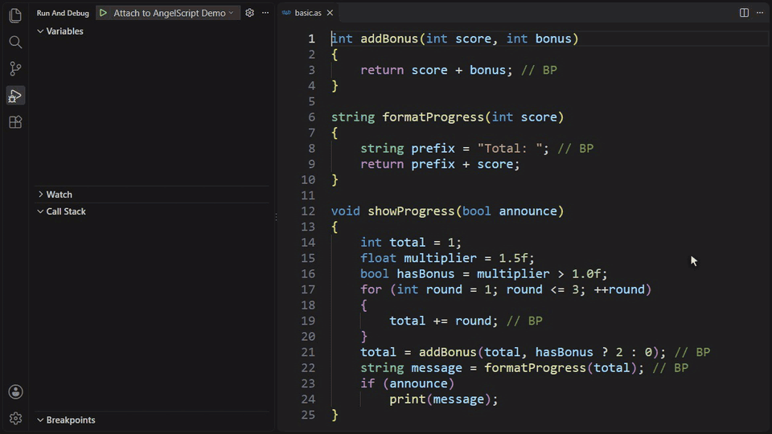
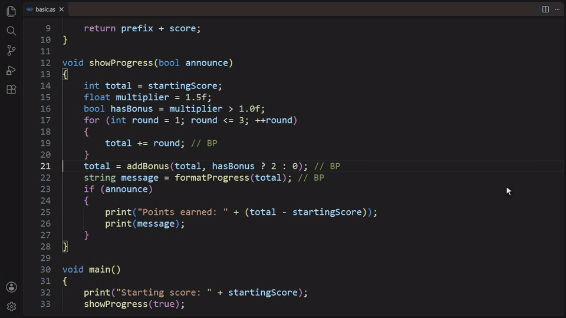

# Ejemplo del depurador de AngelScript

**[English](../README.md)** | **[Español](README.es.md)**

Un pequeño programa anfitrión en C++ para ejecutar y depurar AngelScript desde VS Code.

<p align="center"></p>
<p align="center"><em>Conéctate desde VS Code, ejecuta AngelScript paso a paso e inspecciona las variables y la pila de llamadas.</em></p>

## Inicio rápido
```text
> git clone --recursive https://github.com/Gaftherman/angelscript-debugger-example.git
> cd angelscript-debugger-example
```
```text
> .\run-demo.cmd --build-only
```
Compila `angelscript-demo.exe`.

```text
> code .
> F5
```
Pon un punto de interrupción en una línea marcada con `// BP` en [`scripts/basic.as`](../scripts/basic.as), elige **Launch AngelScript Demo** y pulsa **F5**.

## Iniciar desde VS Code
<p align="center"></p>
<p align="center"><em>Inicia con F5, inspecciona el puntaje y continúa para ver el total.</em></p>

## Conectarse a un anfitrión en ejecución
```text
> .\run-demo.cmd
> F5
```
Cuando aparezca `DAP listening`, elige **Attach to AngelScript Demo** en VS Code y pulsa **F5**.

## Estructura del proyecto
```text
└── 📁 angelscript-debugger-example
    ├── 📁 .vscode
    │   ├── 📄 launch.json         Configuraciones para conectar e iniciar
    │   ├── 📄 settings.json       Ajuste de las declaraciones predefinidas
    │   └── 📄 tasks.json          Tarea de compilación previa al inicio
    ├── 📁 host
    │   └── 📄 main.cpp            Anfitrión en C++, print, Player y servidor DAP
    ├── 📁 scripts
    │   ├── 📄 basic.as            Cálculo del puntaje y llamadas a funciones
    │   ├── 📄 advanced.as         Objetos, colecciones y excepciones
    │   ├── 📄 engine.as           Llamadas al anfitrión y sus callbacks
    │   └── 📄 host.as.predefined  Declaraciones de la API del anfitrión
    ├── 📁 external
    │   ├── 📁 angelscript         Motor de AngelScript (submódulo)
    │   └── 📁 angelscript-dap     Núcleo del depurador (submódulo)
    ├── 📁 media
    └── 📄 run-demo.cmd            Compila y ejecuta la demo
```

## Requisitos
Windows, Git, CMake 3.21+, Ninja, Visual Studio 2022+ o Build Tools con **Desarrollo para el escritorio con C++** (MSVC x64, C++20) y VS Code con la [extensión de AngelScript](https://marketplace.visualstudio.com/items?itemName=Gaftherman.angelscript-gaftherman).

## Usar el depurador en tu propia aplicación
El depurador es el repositorio [angelscript-dap](https://github.com/Gaftherman/angelscript-dap), incluido aquí como submódulo. [`host/main.cpp`](../host/main.cpp) muestra las llamadas que hace una aplicación, y el README de angelscript-dap lista las opciones de CMake.

```cmake
add_subdirectory(external/angelscript-dap)  # después de tu destino de AngelScript
target_link_libraries(my_host PRIVATE angelscript_dap)
```

## Proyectos relacionados

| Proyecto | Uso |
| --- | --- |
| [angelscript-dap](https://github.com/Gaftherman/angelscript-dap) | El núcleo del depurador y su soporte |
| [angelscript-cli](https://github.com/Gaftherman/angelscript-cli) | Ejecuta, comprueba y depura scripts desde la terminal |
| [angelscript-lsp](https://github.com/Gaftherman/angelscript-lsp) | Soporte del editor para VS Code |
| [asdebugger](https://github.com/Gaftherman/asdebugger) | El complemento de Sven Co-op construido sobre el mismo núcleo |

## Licencia
[MIT](../LICENSE). Consulta también [CONTRIBUTING.es.md](CONTRIBUTING.es.md) y [THIRD_PARTY.md](THIRD_PARTY.md).
